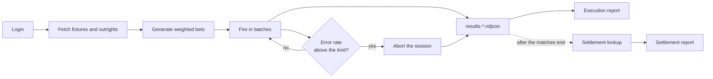

# Bet Volume Testing — siteSportsbook

**English** | [Português](README.pt-BR.md)

A TypeScript and Playwright suite for volume testing a sportsbook API. It
generates bets from real match data, fires the volume in batches with
controlled concurrency, stops the run when the error rate goes over the limit
and checks the outcome of every bet after settlement.

> **Anonymized project.** Based on professional work, with brand, URLs, match
> identifiers and credentials replaced by fictitious values. Because of that,
> the commands that call the API do not work without configuring a real
> environment. The automated tests run offline, right after installation.

## Highlights

- **Service Objects**, the API equivalent of the Page Object Model: each API has one class, and no other layer makes HTTP calls.
- **Weighted bet generation**, with 10 categories, including accumulators (multiples), Bet Builder, live and outright (futures) bets.
- **Guaranteed coverage** of every category, even at small volumes.
- **Per-batch circuit breaker**, which aborts the session if the error rate exceeds the limit or if the token expires (HTTP 401).
- **Production safeguards**: configuration validated before firing, a cap on the total amount at stake and explicit confirmation by typing `PROD`.
- **Multiple sessions in parallel**, each with its own login, data and results.
- **Settlement validation**, which flags inconsistent settlements and can fail a CI pipeline.
- **Self-contained HTML reports** that open without internet access.
- **Offline tests** against a mock server, with no browser and no calls to any real API.

## Stack

TypeScript · Playwright (`APIRequestContext` and Playwright Test) · Faker · ts-node · dotenv · prompts

## Quick start

Requires Node.js 18 or later.

```bash
git clone https://github.com/ricardho/volumetria-sportsbook-api.git
cd volumetria-sportsbook-api
npm install
npm test
```

## How it works



A run has two stages, because a bet's outcome only exists after the match is
over:

1. **Execution:** bets are placed and recorded with the ID returned by the API.
2. **Settlement:** after the matches, each bet is looked up and checked.

## Architecture

```
src/
  config/      environments.ts (single source of URLs), runConfig.ts (reads and validates .env), paths.ts, marketsWeights.json
  api/         apiClient.ts (HTTP context with timeout, standardized result) and services/ (auth, bet, fixture, outrights, settlement)
  types/       contracts for bets, pools and settlement
  parsers/     raw API response -> internal format (fixtures, outrights, bet response)
  logging/     console logger with timestamp and level
  factories/   bet generation by weight and coverage
  flows/       business flows that combine services and parsers
  session/     session persistence in .sessions/<label>/
  runner/      batch executor, concurrency limiter, error classification
  reporting/   execution and settlement HTML reports
  cli/         entry points for the npm commands (shared/ holds the prompts and the production confirmation)
data/
  samples/       examples of the pool format
  raw-fixtures/  manually captured fixture responses
tests/
  unit/          pure rules: factory, parsers, limiter, settlement
  integration/   services, executor and settlement against a mock server
  support/       data builders and mock server
```

Dependencies follow one main direction: `cli → runner/flows → api/services → config`.

## Commands

| Command | What it does |
|---|---|
| `npm run wizard` | Wizard that configures the sessions, runs them in parallel and generates the report |
| `npm run login` | Authenticates and saves only the token, without storing the password |
| `npm run fetch:fixtures -- <IDs or URLs>` | Fetches matches and builds the pools |
| `npm run fetch:outrights -- "<tournament>"` | Fetches outright (futures) markets, filtered by name |
| `npm run build:pool` | Builds the pools from `data/raw-fixtures/` |
| `npm run test:volumetry` | Runs one session configured through environment variables |
| `npm run report` | Generates the execution report |
| `npm run report:settlement` | Looks up the final outcomes and generates the settlement report |
| `npm test` | Runs the suite's automated tests |
| `npm run typecheck` | Checks types without building |

The step-by-step reference is in [COMANDOS.md](COMANDOS.md) (in Portuguese).

## Running against a real environment

> ⚠️ This suite places real bets and, in production, moves real money.
> Use it only with authorization from the platform owner.

1. Configure the URLs in `src/config/environments.ts`.
2. Adapt the Service Objects in `src/api/services/` to your API's contract.
3. Run `npm run wizard`. It guides you through login, matches, volume and
   amount, shows the total in BRL (R$) and asks for confirmation before firing.

To configure each step manually, copy `.env.example` to `.env`:

```bash
npm run login
npm run fetch:fixtures -- colocarAquiGameIds colocarAquiGameIds
SITE_SPORTSBOOK_FIXTURES_PATH=./fixtures.prod.json npm run test:volumetry
npm run report
```

### Configuration

| Variable | Description | Default |
|---|---|---|
| `SITE_SPORTSBOOK_ENV` | Environment: `preprod` or `prod` | `preprod` |
| `SITE_SPORTSBOOK_SESSION_LABEL` | Session used in the run | `default` |
| `SITE_SPORTSBOOK_TOTAL_BETS` | Total number of bets (`test:volumetry`) | **required** |
| `SITE_SPORTSBOOK_BATCH_SIZE` | Size of each batch | `100` (or the total, if smaller) |
| `SITE_SPORTSBOOK_CONCURRENCY` | Concurrent requests per session | `5` for execution, `10` for settlement |
| `SITE_SPORTSBOOK_ERROR_THRESHOLD` | Error rate that aborts the session (0 to 1) | `0.02` |
| `SITE_SPORTSBOOK_BET_AMOUNT` | Fixed amount per bet | random within the configured range |
| `SITE_SPORTSBOOK_MIN_PER_CATEGORY` | Guaranteed minimum per category (`test:volumetry` only) | no minimum |
| `SITE_SPORTSBOOK_MAX_TOTAL_VALUE` | Cap on the amount (R$) at stake per run; above it nothing is fired | no cap |

Values are validated before any bet is placed: an invalid or negative number,
or a threshold outside 0–1, stops the run with an error. The wizard uses the
same batch, concurrency, threshold and cap variables.

### Execution safeguards

- **Per-batch circuit breaker**: the session aborts when a batch's error rate
  goes over the threshold. Bet Builder selection-conflict rejections do not
  count, because they are expected.
- **Expired token**: an HTTP 401 stops the session immediately; the remaining
  bets in the batch are not sent.
- **Production**: `test:volumetry` and the wizard ask you to type `PROD` before
  starting. Outside an interactive terminal, use
  `npm run test:volumetry -- --confirmar-prod`.
- **Synced folder**: if the project is in OneDrive, Dropbox or similar, the
  suite warns that tokens and customer data will be uploaded to the cloud.
  Prefer a local folder.

Weights, the amount range and the size of accumulators and Bet Builders are in
[`src/config/marketsWeights.json`](src/config/marketsWeights.json).

Start with a small volume in pre-production and increase it in stages,
checking the results and the settlement of each stage before moving on.

## Generation rules

### Category coverage

Before firing any bet, the executor checks that every category with a
configured weight has markets available in the session's pools:

- **Weighted draw:** categories without coverage are excluded with a warning, and the session continues.
- **With `SITE_SPORTSBOOK_MIN_PER_CATEGORY`:** the session stops before the first bet and reports which category is missing.

In guaranteed-minimum mode, the rest of the volume follows the weights and the final order is shuffled.

### Accumulators and Bet Builder

- **Accumulators** combine selections from different matches.
- **Bet Builders** combine selections from the same match, with at most one market per family, to reduce correlation rejections.

When the API rejects a combination due to a conflict, the result is recorded
as `conflito_selecao` (selection conflict), separately from `erro` (error), so
that expected rejections show up apart from system failures in the report.

### Multiple sessions

Each session lives in `.sessions/<label>/`, with its own token, matches and
results, and no shared pool. The wizard runs them all in parallel, simulating
several users at the same time.

## Reports

### Execution — `npm run report`

Generates an HTML report with the success rate, count per status, a chart, a
comparison between sessions and the details of each bet. It reflects the
**moment the bet was placed**.

### Settlement — `npm run report:settlement`

Looks up each accepted bet by its `apostaId`, writes `settlement-*.ndjson`
without changing the original file and generates an HTML report with the
final outcome, total staked, total returned and GGR (gross gaming revenue). It
can be repeated until no pending bets remain.

Each settlement is also validated:

| Outcome | Flagged as inconsistent when |
|---|---|
| `ganhou` (won) | the return is less than or equal to the amount staked |
| `perdeu` (lost) | the return is not zero |
| `devolvida` (voided / refunded) | the return differs from the amount staked |
| any settled bet | the return amount or the settlement date is missing |
| value outside the contract | always |

If there is any inconsistency, the command exits with code 1. If the token
expires, the run stops and tells you to run `npm run login` again.

> **Demo contract:** settlement uses a fictitious contract,
> `GET /sportsbook/bet/{id}`, which returns
> `{ bet: { id, codigo, resultado, valor_retorno, liquidada_em } }`, and was
> tested against a mock server. For a real API, adapt
> `src/api/services/settlementService.ts` and `interpretSettlementResponse` in
> `src/flows/settlementFlow.ts`.

## Tests

```bash
npm test
```

No test needs a browser or internet access. The integration tests start a
local HTTP server, and the coverage includes:

- bet generation, per-category coverage and accumulator rules;
- parsing of pre-match and live fixtures;
- concurrency limit and error classification;
- the Service Objects' HTTP contract and interpretation of the bet response;
- validation of the `.env` variables and the total amount cap;
- batch execution, authentication and the circuit breaker (including the default batch, selection conflicts, HTTP 401 and a token from another environment);
- settlement, expired token and financial consolidation;
- a check that every configured URL uses the fictitious domain.

## Known limitations

- The `refreshToken` in `authService.ts` is an unvalidated hypothesis and is not used by the flows.
- The Correlation ID identifies each bet only in the local log. Matching with settlement uses `apostaId` and `codigoRetornado`.
- Selection conflicts are recognized by the message text (`CONFLICT_PATTERNS` in `src/runner/errorClassifier.ts`), observed in the UI and not yet confirmed in the API's JSON.
- Markets with a `marketId` outside `MARKET_CATEGORY_BY_ID` (`src/parsers/fixtureParser.ts`) are ignored.
- The files in `data/samples/` document the format, but contain `colocarAquiGameIds` in place of the IDs and must be filled in before a run.
