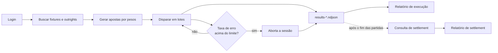

# Volumetria de Apostas — siteSportsbook

[English](README.md) | **Português**

Suíte em TypeScript e Playwright para testes de volumetria em uma API de
sportsbook. Ela gera apostas a partir de dados reais de partidas, dispara o
volume em lotes com concorrência controlada, interrompe a execução quando a
taxa de erro passa do limite e confere o resultado de cada aposta depois do
settlement.

> **Projeto anonimizado.** Baseado em um trabalho profissional, com marca, URLs,
> identificadores de partidas e credenciais substituídos por valores fictícios.
> Por isso, os comandos que chamam a API não funcionam sem configurar um
> ambiente real. Os testes automatizados rodam offline, logo após a instalação.

## Destaques

- **Service Objects**, o equivalente ao Page Object Model para APIs: cada API tem uma classe, e nenhuma outra camada faz HTTP.
- **Geração de apostas por pesos**, com 10 categorias, incluindo múltiplas, Bet Builder, ao vivo e Aposta Futura.
- **Cobertura garantida** de cada categoria, mesmo em volumes pequenos.
- **Circuit breaker** por lote, que aborta a sessão se a taxa de erro ultrapassar o limite ou se o token expirar (HTTP 401).
- **Travas para produção**: configuração validada antes de disparar, teto de valor total e confirmação explícita digitando `PROD`.
- **Múltiplas sessões em paralelo**, cada uma com login, dados e resultados próprios.
- **Validação de settlement**, que aponta liquidações incoerentes e pode falhar um pipeline de CI.
- **Relatórios HTML autocontidos**, que abrem sem internet.
- **Testes offline** contra servidor mock, sem browser e sem nenhuma chamada a API real.

## Stack

TypeScript · Playwright (`APIRequestContext` e Playwright Test) · Faker · ts-node · dotenv · prompts

## Início rápido

Requer Node.js 18 ou superior.

```bash
git clone https://github.com/ricardho/volumetria-sportsbook-api.git
cd volumetria-sportsbook-api
npm install
npm test
```

## Como funciona



A execução tem dois momentos, porque o resultado de uma aposta só existe depois
do fim da partida:

1. **Execução:** as apostas são criadas e registradas com o ID devolvido pela API.
2. **Settlement:** depois das partidas, cada aposta é consultada e conferida.

## Arquitetura

```
src/
  config/      environments.ts (fonte única das URLs), runConfig.ts (leitura e validação do .env), paths.ts, marketsWeights.json
  api/         apiClient.ts (contexto HTTP com timeout, resultado padronizado) e services/ (auth, bet, fixture, outrights, settlement)
  types/       contratos das apostas, dos pools e do settlement
  parsers/     resposta bruta da API -> formato interno (fixtures, outrights, resposta da aposta)
  logging/     logger de console com timestamp e nível
  factories/   geração de apostas por peso e cobertura
  flows/       fluxos de negócio que combinam services e parsers
  session/     persistência das sessões em .sessions/<rótulo>/
  runner/      executor em lotes, limitador de concorrência, classificação de erros
  reporting/   relatórios HTML de execução e de settlement
  cli/         pontos de entrada dos comandos npm (shared/ com os prompts e a confirmação de produção)
data/
  samples/       exemplos do formato dos pools
  raw-fixtures/  respostas de fixture capturadas manualmente
tests/
  unit/          regras puras: factory, parsers, limitador, settlement
  integration/   services, executor e settlement contra servidor mock
  support/       builders de dados e mock server
```

As dependências seguem uma direção principal: `cli → runner/flows → api/services → config`.

## Comandos

| Comando | O que faz |
|---|---|
| `npm run wizard` | Assistente que configura as sessões, executa em paralelo e gera o relatório |
| `npm run login` | Autentica e salva somente o token, sem gravar a senha |
| `npm run fetch:fixtures -- <IDs ou URLs>` | Busca partidas e monta os pools |
| `npm run fetch:outrights -- "<torneio>"` | Busca mercados de Aposta Futura, filtrando pelo nome |
| `npm run build:pool` | Monta os pools a partir de `data/raw-fixtures/` |
| `npm run test:volumetry` | Executa uma sessão configurada por variáveis de ambiente |
| `npm run report` | Gera o relatório de execução |
| `npm run report:settlement` | Consulta os resultados finais e gera o relatório de settlement |
| `npm test` | Roda os testes automatizados da suíte |
| `npm run typecheck` | Verifica os tipos sem gerar build |

A referência passo a passo está em [COMANDOS.md](COMANDOS.md).

## Executando contra um ambiente real

> ⚠️ Esta suíte cria apostas de verdade e, em produção, movimenta dinheiro real.
> Use somente com autorização do responsável pela plataforma.

1. Configure as URLs em `src/config/environments.ts`.
2. Ajuste os Service Objects em `src/api/services/` ao contrato da sua API.
3. Rode `npm run wizard`. Ele conduz login, partidas, volume e valor, mostra o
   total em R$ e pede confirmação antes de disparar.

Para configurar cada etapa manualmente, copie `.env.example` para `.env`:

```bash
npm run login
npm run fetch:fixtures -- colocarAquiGameIds colocarAquiGameIds
SITE_SPORTSBOOK_FIXTURES_PATH=./fixtures.prod.json npm run test:volumetry
npm run report
```

### Configuração

| Variável | Descrição | Padrão |
|---|---|---|
| `SITE_SPORTSBOOK_ENV` | Ambiente: `preprod` ou `prod` | `preprod` |
| `SITE_SPORTSBOOK_SESSION_LABEL` | Sessão usada na execução | `default` |
| `SITE_SPORTSBOOK_TOTAL_BETS` | Total de apostas (`test:volumetry`) | **obrigatório** |
| `SITE_SPORTSBOOK_BATCH_SIZE` | Tamanho de cada lote | `100` (ou o total, se menor) |
| `SITE_SPORTSBOOK_CONCURRENCY` | Requisições simultâneas por sessão | `5` na execução, `10` no settlement |
| `SITE_SPORTSBOOK_ERROR_THRESHOLD` | Taxa de erro que aborta a sessão (0 a 1) | `0.02` |
| `SITE_SPORTSBOOK_BET_AMOUNT` | Valor fixo por aposta | sorteado na faixa configurada |
| `SITE_SPORTSBOOK_MIN_PER_CATEGORY` | Mínimo garantido por categoria (só `test:volumetry`) | sem mínimo |
| `SITE_SPORTSBOOK_MAX_TOTAL_VALUE` | Teto de R$ em jogo por execução; acima dele nada é disparado | sem teto |

Os valores são validados antes de qualquer aposta: número inválido, negativo ou
threshold fora de 0–1 interrompe com erro. O wizard usa as mesmas variáveis de
lote, concorrência, threshold e teto.

### Proteções da execução

- **Circuit breaker por lote**: a sessão aborta quando a taxa de erro de um lote
  passa do threshold. Rejeições por conflito de seleções do Bet Builder não
  contam, porque são esperadas.
- **Token expirado**: um HTTP 401 interrompe a sessão na hora; as apostas
  restantes do lote não são enviadas.
- **Produção**: `test:volumetry` e o wizard pedem para digitar `PROD` antes de
  começar. Fora de um terminal interativo, use
  `npm run test:volumetry -- --confirmar-prod`.
- **Pasta sincronizada**: se o projeto estiver em OneDrive, Dropbox ou similar,
  a suíte avisa que tokens e dados de clientes vão para a nuvem. Prefira uma
  pasta local.

Pesos, faixa de valores e tamanho de múltiplas e Bet Builders ficam em
[`src/config/marketsWeights.json`](src/config/marketsWeights.json).

Comece com um volume pequeno em pré-produção e aumente em etapas, conferindo os
resultados e o settlement de cada etapa antes de seguir.

## Regras de geração

### Cobertura de categorias

Antes de disparar qualquer aposta, o executor verifica se cada categoria com
peso configurado tem mercados disponíveis nos pools da sessão:

- **Sorteio por pesos:** categorias sem cobertura são excluídas com um aviso, e a sessão continua.
- **Com `SITE_SPORTSBOOK_MIN_PER_CATEGORY`:** a sessão para antes da primeira aposta e informa qual categoria falta.

No modo com mínimo garantido, o restante do volume segue os pesos e a ordem final é embaralhada.

### Múltiplas e Bet Builder

- **Múltiplas** combinam seleções de partidas diferentes.
- **Bet Builders** combinam seleções da mesma partida, com no máximo um mercado por família, para reduzir rejeições por correlação.

Quando a API rejeita uma combinação por conflito, o resultado é registrado como
`conflito_selecao`, separado de `erro`, para que a rejeição esperada apareça
distinta das falhas de sistema no relatório.

### Múltiplas sessões

Cada sessão vive em `.sessions/<rótulo>/`, com token, partidas e resultados
próprios, sem pool compartilhado. O wizard executa todas em paralelo, simulando
vários usuários ao mesmo tempo.

## Relatórios

### Execução — `npm run report`

Gera um HTML com taxa de sucesso, contagem por status, gráfico, comparação entre
sessões e detalhe de cada aposta. Reflete o **momento da criação** da aposta.

### Settlement — `npm run report:settlement`

Consulta cada aposta aceita pelo `apostaId`, grava `settlement-*.ndjson` sem
alterar o arquivo original e gera um HTML com resultado final, total apostado,
total retornado e GGR. Pode ser repetido até não restarem apostas pendentes.

Cada liquidação também é validada:

| Resultado | É apontado como inconsistência quando |
|---|---|
| `ganhou` | o retorno é menor ou igual ao valor apostado |
| `perdeu` | o retorno é diferente de zero |
| `devolvida` | o retorno é diferente do valor apostado |
| qualquer liquidada | falta o valor de retorno ou a data de liquidação |
| valor fora do contrato | sempre |

Havendo inconsistência, o comando termina com código de saída 1. Se o token
expirar, a execução para e orienta um novo `npm run login`.

> **Contrato de demonstração:** o settlement usa um contrato fictício,
> `GET /sportsbook/bet/{id}`, que retorna
> `{ bet: { id, codigo, resultado, valor_retorno, liquidada_em } }`, e foi
> testado contra servidor mock. Para uma API real, ajuste
> `src/api/services/settlementService.ts` e `interpretSettlementResponse` em
> `src/flows/settlementFlow.ts`.

## Testes

```bash
npm test
```

Nenhum teste precisa de browser ou internet. As integrações sobem um servidor
HTTP local, e a cobertura inclui:

- geração de apostas, cobertura por categoria e regras de múltiplas;
- parsing de fixtures pré-jogo e ao vivo;
- limite de concorrência e classificação de erros;
- contrato HTTP dos Service Objects e interpretação da resposta da aposta;
- validação das variáveis do `.env` e teto de valor total;
- execução em lotes, autenticação e circuit breaker (inclusive lote padrão, conflitos de seleção, HTTP 401 e token de outro ambiente);
- settlement, token expirado e consolidação financeira;
- garantia de que todas as URLs configuradas usam o domínio fictício.

## Limitações conhecidas

- O `refreshToken` em `authService.ts` é uma hipótese não validada e não é usado pelos fluxos.
- O Correlation ID identifica cada aposta só no log local. O cruzamento com o settlement usa `apostaId` e `codigoRetornado`.
- O conflito de seleções é reconhecido pelo texto da mensagem (`CONFLICT_PATTERNS` em `src/runner/errorClassifier.ts`), observado na UI e ainda não confirmado no JSON da API.
- Mercados com `marketId` fora de `MARKET_CATEGORY_BY_ID` (`src/parsers/fixtureParser.ts`) são ignorados.
- Os arquivos em `data/samples/` documentam o formato, mas trazem `colocarAquiGameIds` no lugar dos IDs e precisam ser preenchidos antes de uma execução.
